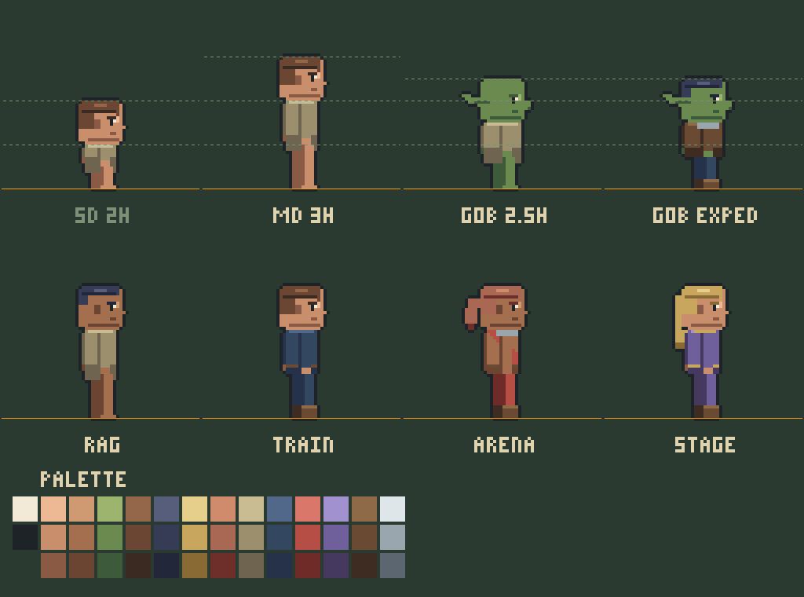
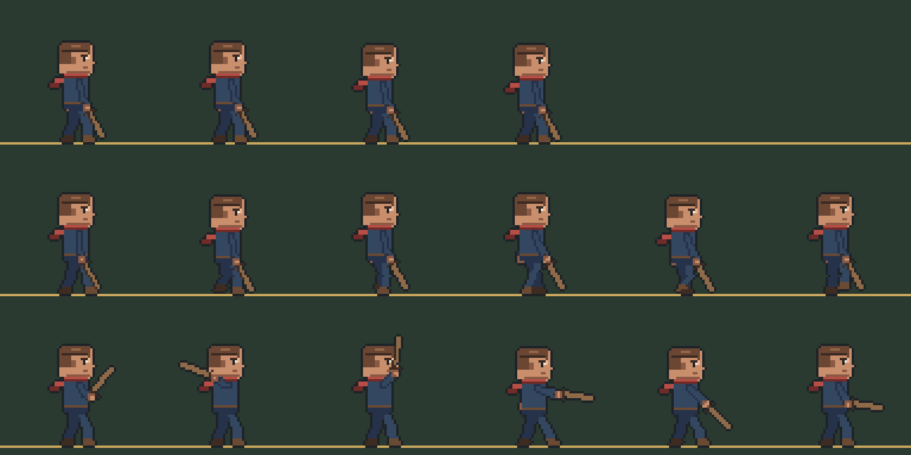

# 캐릭터 바이블 — 이끼송곳니 거점

작성: 2026-11-11. 모든 캐릭터 도트(인간 육성 인물, 고블린 운영자·원정대)가 따르는 단일 기준이다. 새 캐릭터를 만들거나 생성 결과를 받아들일 때 이 문서와 [기준 시트](../Art/Bible/character-template-sheet.png)를 먼저 확인한다.



> 시트의 인물은 **비율·색·구성 규칙을 보여주는 기준 틀**이다. 완성 그림이 아니며, 실제 캐릭터는 이 틀 위에 그린다.

## 0. 이 문서가 해결하려는 문제

캐릭터마다 따로 생성하거나 그리면 머리 크기, 눈 모양, 외곽선, 색 수, 발 위치가 조금씩 달라진다. 이 차이가 쌓이면 "한 게임 그림"으로 보이지 않는다. 그래서 **바뀌지 않는 것**(틀)과 **바꿔도 되는 것**(부품)을 나눈다.

- **고정**: 픽셀 배율, 캔버스, 발 기준점, 머리 틀 14×14, 눈 2px, 외곽선 색, 광원, 팔레트.
- **교체 가능**: 머리 모양 4종, 머리색 4종, 피부 2종, 의상 등급, 소품.

캐릭터 한 명은 **부품의 조합**으로 정의한다. 새 얼굴을 매번 디자인하지 않는다.

## 1. 등신 결정

| 대상 | 등신 | 전체 키 | 머리 | 몸통 | 다리 | 몸통 폭 |
| --- | --- | --- | --- | --- | --- | --- |
| 인간 육성 인물 | **MD 3등신** | 42px | 14 | 14 | 14 | 10 |
| 고블린 (운영자·원정대) | **2.5등신** | 35px | 14 | 11 | 10 | 12 |
| SD 2등신 | 비교용, 미채택 | 28px | 14 | 7 | 7 | 10 |

결정 이유:

- 육성 인물은 **검투(무기 휘두르기)와 공연(춤·악기)**을 해야 한다. SD 2등신은 팔다리가 7px뿐이라 동작이 거의 읽히지 않는다. MD 3등신은 팔다리 14px로 공격·춤 자세를 구분할 수 있으면서도 머리가 커서 표정이 보인다.
- **모든 캐릭터의 머리 크기가 같다(14×14).** 종족 차이는 머리가 아니라 몸 길이·폭과 귀·코로 낸다. 같은 머리 틀을 공유하므로 얼굴 그림체가 섞이지 않는다.
- 고블린을 더 작고 땅딸막하게 해서 **"누가 운영자이고 누가 육성 대상인지"를 키와 실루엣만으로 2초 안에 구분**할 수 있다.
- 인간을 SD로 바꾸고 싶으면 이 표의 몸통·다리만 7로 바꾸면 된다. 머리 틀·팔레트·규칙은 그대로 유지된다.

## 2. 고정 규격

| 항목 | 값 |
| --- | --- |
| 픽셀 배율 | 화면 표시 시 **정수 배율만**(×2 기본). 1.2배 같은 소수 배율 금지 |
| 캐릭터 캔버스 | **64×64px**, 모든 동작 공통 |
| 발 기준점(피벗) | **(32, 60)** — 발바닥 아래 행이 y=60 |
| 방향 | 오른쪽을 보는 옆모습으로 그림. 왼쪽은 좌우 반전 |
| 머리 틀 | 14×14, 네 모서리 1px 깎음, 얼굴은 오른쪽 |
| 눈 | 외곽선색 1×2px + 흰자 1px. **모든 캐릭터 동일 위치** (머리 기준 x+10, y+6) |
| 코 | 인간 1px 돌출, 고블린 2×3px 긴 코 |
| 귀 | 인간 2×3 작은 귀, 고블린은 뒤로 뻗은 큰 귀(종족 표식) |
| 외곽선 | 바깥 1px, `#1e2328`(순검정 금지). 안쪽 경계는 외곽선 대신 **그 재료의 가장 어두운 색**으로 1px |
| 광원 | **위쪽(정수리) 고정.** 윗면 밝게, 아랫면 어둡게. 좌우 반전해도 빛이 어긋나지 않는다 |
| 먼 쪽 팔다리 | 항상 한 단계 어두운 색 |
| 명암 | 재료당 3단계(어둠·기본·밝음). 디더링·안티에일리어싱 없음 |
| 하이라이트 | 머리카락에 1개 덩어리(3~4px)만. 반짝임 점 남발 금지 |

## 3. 팔레트

마스터 팔레트: [Art/Bible/palette.json](../Art/Bible/palette.json) — 외곽선·흰자 2색과 3단계 램프 13개, 총 41색. Pixelbolt 레시피에서 `"palette": {"$ref": "../../Art/Bible/palette.json"}`로 그대로 불러 쓸 수 있다.

| 램프 | 키 | 용도 |
| --- | --- | --- |
| 피부 밝음 / 피부 갈색 | `a b c` / `d e f` | 인간 육성 인물 |
| 고블린 피부 | `g h i` | 거점 UI의 이끼색 `#97ac76`과 같은 계열 |
| 머리색 | `j k l` 갈색, `m n p` 검정, `q r s` 금발, `t u v` 적발 | `r`은 UI 보상 황동색, `u`는 UI 경고 장미색과 같은 값 |
| 의상 0단계 누더기 | `x y z` | 막 데려온 인원 |
| 의상 1단계 훈련복 | `A B C` | 교육 중 |
| 의상 2단계 경기 | `D E F` | 검투·경기 특화 |
| 의상 2단계 공연 | `G H I` | 공연·흥행 특화 |
| 가죽 / 금속 | `J K L` / `M N O` | 허리띠·신발·고블린 장비 / 갑옷·무기 |

규칙:

- **한 캐릭터는 외곽선 포함 16색 이하.** 기준 시트의 캐릭터는 8~14색이다.
- 팔레트에 없는 색을 추가하지 않는다. 필요하면 이 파일에 램프 단위(3색)로 추가하고 문서를 갱신한다.
- 생성 이미지는 반드시 이 팔레트로 **색 고정(양자화)**한 뒤 사용한다.

## 4. 의상 등급 = 성장의 시각화

경영 게임의 보상(숙련도·평가액 상승)을 UI 숫자뿐 아니라 **겉모습으로도** 보이게 한다. 같은 사람이라도 등급이 오르면 옷이 바뀐다.

| 등급 | 조건(제안) | 외형 |
| --- | --- | --- |
| 0 누더기 `RAG` | 막 확보한 인원 | 리넨 튜닉, 맨다리·맨발 |
| 1 훈련복 `TRAIN` | 교육 1회 이상 | 남색 튜닉·바지, 가죽 장화 |
| 2 경기 `ARENA` | 무예 특화 | 맨가슴 + 붉은 띠, 금속 어깨판 |
| 2 공연 `STAGE` | 예능 특화 | 보라 의상, 황동 깃·허리띠 |

등급 전환 조건은 [RaisingManagement.md](RaisingManagement.md)의 수치와 맞출 때 확정한다. 지금 단계에서는 외형 규칙만 정한다.

## 5. 부품 목록

캐릭터 = **피부 × 머리 모양 × 머리색 × 의상 등급 (+ 소품 1개 이하)**.

| 부품 | 종류 |
| --- | --- |
| 머리 모양 | `short` 짧은 머리, `crop` 바짝 깎은 머리, `tail` 뒤로 묶은 머리, `long` 긴 머리 |
| 머리색 | 갈색·검정·금발·적발 |
| 피부 | 인간 밝음·갈색, 고블린 1종 |
| 소품(선택) | 무기 1개 또는 악기 1개. 몸에 붙은 장신구 금지 |

조합만 해도 인간 4×4×2 = 32가지 외형이 나온다. 이름이 있는 주요 인물만 고유 부품 1개(흉터, 머리띠 등)를 추가한다.

**금지**: 주머니, 끈, 버클, 문양, 겹친 갑옷판, 잔머리, 찢어진 천 끝. 기존 검사를 단순화하던 원칙([ArtDirection.md](ArtDirection.md))을 이어받는다.

## 6. 애니메이션 규격

| 동작 | 프레임 | 길이 | 비고 |
| --- | --- | --- | --- |
| idle 대기 | 4 | 각 200ms | 상체(머리·몸통·팔)가 함께 1px 내려가는 호흡. 머리 틀 모양은 그대로 |
| walk 걷기 | 6 | 각 110ms | 머리 1px 상하 |
| attack 공격 | 6 | 80/80/60/140/100/100ms | 4번째 프레임이 타격, 가장 길게 |
| perform 공연 | 6 | 각 140ms | 팔 위주, 발은 기준선 유지 |
| rest 휴식 | 2 | 각 600ms | 앉은 자세. 발 대신 엉덩이가 기준선 |
| hurt 피격 | 2 | 80/200ms | 뒤로 1px |

- 모든 프레임에서 **발 기준점 (32,60) 고정**. 프레임마다 캐릭터 크기를 바꾸지 않는다.
- 무기·이펙트가 64×64를 넘으면 캐릭터를 줄이지 말고 이펙트를 별도 레이어로 그린다.
- 기존 검사의 14프레임(128×112) 동작은 새 규격으로 다시 만든다. 42px 캐릭터에 14프레임은 프레임 간 차이가 1px도 안 나서 오히려 떨려 보인다.

## 7. 초상화

상세창 초상화도 **같은 팔레트의 도트**를 쓴다. 일러스트 초상화와 도트를 섞으면 "그림체 섞임"이 가장 먼저 눈에 띈다.

- **1단계(현재 적용)**: 대기 첫 프레임의 상반신(x 20~43, y 14~45, 24×32)을 그대로 잘라 ×2(48×64)로 표시한다. 스프라이트와 픽셀 단위로 같으므로 어긋날 수 없다.
- **2단계(나중)**: 표정이 필요해지면 48×48 정면 3/4 초상화를 따로 그린다. 도트에 없는 장비를 추가하지 않고 표정만 늘린다.

## 8. 제작 경로

1. **틀에서 시작**: [human-md.png](../Art/Bible/templates/human-md.png), [goblin.png](../Art/Bible/templates/goblin.png)(64×64, 피벗 32,60)를 깔고 그 위에 그린다.
2. **도구**: [Tools/lib/pixel-character.mjs](../Tools/lib/pixel-character.mjs)의 공용 머리 틀·외곽선·팔레트로 자세를 조립하는 방식이 기준 구현이다([루카 빌더](../Tools/build-luka-sprite.mjs) 참고). 손 도트나 Pixelbolt 레시피(팔레트 `$ref`)도 쓸 수 있다. 42px 캐릭터는 이미지 생성보다 직접 그리기가 더 일관적이다. 동작은 Pixelbolt `poses` 템플릿이나 `2dimg2motion`을 쓰되 6장 규격으로 맞춘다.
3. **생성 이미지를 쓸 때**: 아래 프롬프트 틀의 고정 문구를 매번 그대로 넣고, 결과를 64×64로 줄인 뒤 마스터 팔레트로 양자화하고, 머리 틀·눈 위치를 틀에 맞춰 손으로 고친다.
4. **QA 체크리스트**를 통과한 것만 `Assets/Characters/`에 넣는다.

### 생성 프롬프트 고정 문구

```text
pixel art game sprite, strict side view facing right, MD 3-head proportions
(head 1/3 of height) [goblin: 2.5-head, stocky, large swept-back ears, long nose],
flat 3-tone shading with light from directly above, 1px dark outline #1e2328,
no anti-aliasing, no dithering, limited palette, simple clothing without pouches,
straps, buckles or patterns, transparent background, single character, full body,
feet on one baseline.
Character: [피부] skin, [머리 모양] [머리색] hair, wearing [의상 등급 문구].
```

## 9. QA 체크리스트 (새 캐릭터·새 프레임마다)

- [ ] 캔버스 64×64, 발이 y=60에 닿는가
- [ ] 머리가 14×14 틀과 겹치는가(크기·위치)
- [ ] 눈이 1×2 + 흰자 1px, 틀과 같은 위치인가
- [ ] 키가 인간 42px / 고블린 35px인가
- [ ] 모든 색이 palette.json 안에 있고 16색 이하인가
- [ ] 바깥 외곽선이 `#1e2328` 1px이고 순검정이 없는가
- [ ] 빛이 위에서 오고, 먼 쪽 팔다리가 한 단계 어두운가
- [ ] 금지 장식(주머니·끈·문양·잔머리)이 없는가
- [ ] 실제 게임 배율(×2)에서 다른 캐릭터와 나란히 놓았을 때 같은 게임처럼 보이는가
- [ ] 검은 실루엣만으로 인간/고블린과 머리 모양을 구분할 수 있는가

## 10. 아직 결정하지 않은 것

- **배경과의 픽셀 밀도 차이**: 현재 [거점 배경](../Assets/Environments/goblin-camp.png)은 생성 이미지라 픽셀 크기가 일정하지 않다. ×2 정수 배율 캐릭터와 나란히 두면 배경이 더 세밀해 보인다. 배경을 같은 배율로 다시 도트화할지는 캐릭터 1명을 게임에 넣어 본 뒤 정한다.
- **화면 배율 적용**: 새 규격 캐릭터는 아틀라스의 `scale: 2`로 ×2 표시한다(`Prototype/game.js`의 `drawSprite`). 아직 새로 그리지 않은 캐릭터는 기존 검사 도트를 1.2배로 표시한다.
- **픽셀 UI**: UI 패널·버튼은 같은 ×2 배율과 이 팔레트(특히 `o`, `r`, `u`, 이끼색)를 공유한다. 세부 규칙은 UI 작업 때 `game-ui-ux` 스킬과 함께 별도 문서로 정한다.

## 11. 적용 기록 — 루카 (2026-11-11)

이 바이블로 처음 만든 캐릭터다. 시작 인원 루카(무예 적성)에게만 적용했고, 에린과 새로 확보하는 인원은 기존 검사 도트를 그대로 쓴다.



| 항목 | 값 |
| --- | --- |
| 부품 | 피부 밝음 · `short` 갈색 머리 · 의상 1단계 훈련복 · 고유 부품 붉은 짧은 목도리 · 소품 목검 |
| 색 수 | 15색 (`ABDEJKLabcjklow`), 기준 16색 이하 |
| 동작 | 대기 4장(800ms), 걷기 6장(660ms), 공격 6장(560ms, 4번째 140ms가 타격) |
| 파일 | [atlas.png·atlas.json](../Assets/Characters/luka/atlas.json), [portrait.png](../Assets/Characters/luka/portrait.png), 빌더 [build-luka-sprite.mjs](../Tools/build-luka-sprite.mjs) |
| 게임 연결 | `Prototype/game.js`의 `CUSTOM_SPRITES`에 이름으로 등록. 아틀라스를 불러오지 못하면 기존 검사 도트로 대체 |

확인한 것:

- 프레임 시트를 ×4로 확대해 16장 모두 발이 기준선에 닿는 것, 머리 틀·눈 위치가 고정된 것, 색 수를 확인했다. 빌더가 16색을 넘으면 오류로 멈춘다.
- 실제 브라우저에서 아틀라스·초상화가 200으로 로드되고, 루카가 ×2(키 84px)로 에린(1.2배, 약 83px)과 같은 기준선에 서는 것, 목록·상세창에 도트 초상화가 나오는 것, 무예 교육을 시작하면 교육 마당으로 이동하는 것을 확인했다.
- 기존 자동 테스트 35개 통과.

확인하지 못한 것과 관찰:

- 브라우저 창이 숨겨진 상태라 게임 안의 **연속 재생 속도는 확인하지 못했다.** 동작은 프레임 시트로만 검수했다.
- 에린(기존 검사 도트) 옆에 서면 **그림체 차이가 바로 보인다.** 루카는 큰 색면과 굵은 픽셀, 에린은 잘고 세밀한 픽셀이다. 바이블이 막으려는 "그림체 섞임"이 지금 화면에서 실제로 생기므로, 나머지 인원도 같은 규격으로 바꿔야 해결된다.
- 배경도 루카보다 세밀하다(10절). 인원 교체 후 다시 비교한다.

## 재생성

```bash
node Tools/build-character-bible-sheet.mjs
```

```bash
node Tools/build-luka-sprite.mjs
```

[palette.json](../Art/Bible/palette.json)을 바꾸면 이 명령으로 기준 시트와 틀 PNG를 다시 만든다. 비율 수치는 스크립트의 `KINDS`와 이 문서 1절을 함께 고친다.
